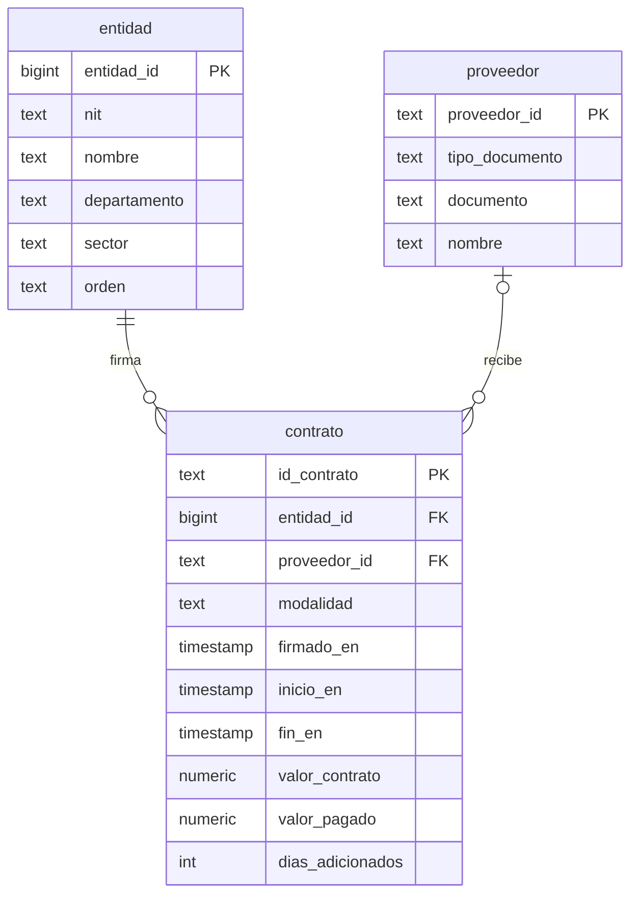
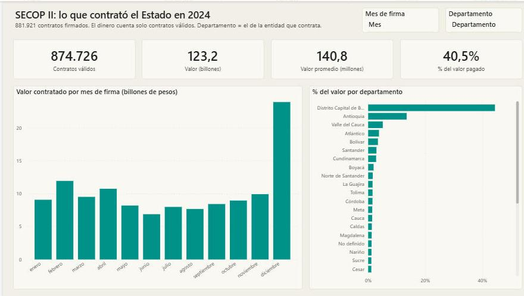
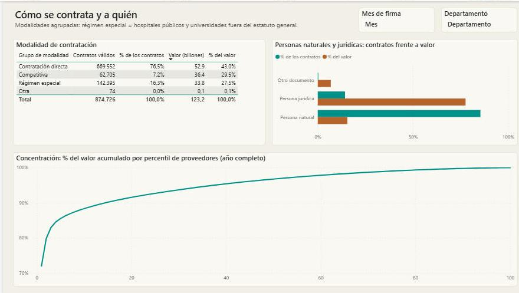
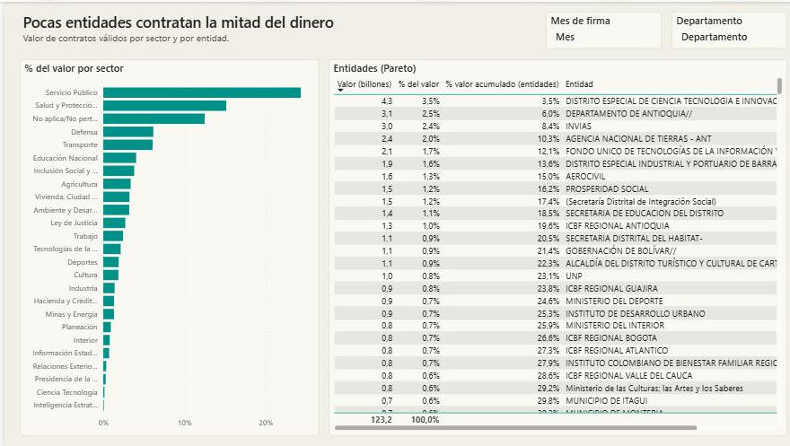
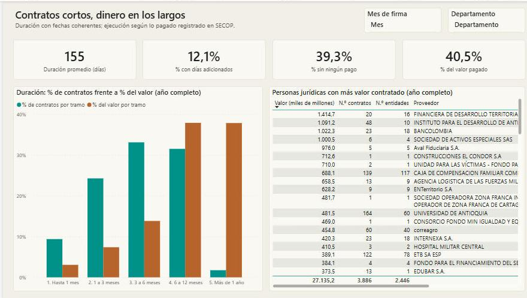

# SECOP II: la contratación estatal de Colombia con PostgreSQL

Descargué de datos.gov.co los 881.921 contratos que las entidades públicas colombianas firmaron en SECOP II durante 2024, los cargué en PostgreSQL y les hice las preguntas que le haría un ciudadano o un auditor: cuánto se contrató, quién recibe el dinero, cómo se contrata y qué tan confiables son los datos.

**Dashboard en vivo:** https://jorvalfe6-byte.github.io/secop-sql-analytics/

El dashboard es una sola página estática. Lee un JSON de 19 KB con resultados ya agregados y dibuja los gráficos sin librerías externas, con modo oscuro y a buen tamaño en el celular.

**Informe de Power BI:** el mismo análisis en un informe de 4 páginas, en [`powerbi/`](powerbi/) ([más abajo](#informe-de-power-bi)).

## Lo que encontré

Todos los montos son pesos colombianos (COP) y salen de los 874.726 contratos que quedaron como válidos (el 99,2 % de los 881.921 firmados; en la sección de decisiones explico qué dejé fuera y por qué).

- **Se contrataron $ 123,2 billones en 2024** (un billón es un millón de millones), con un contrato mediano de $ 18 millones. Es un año con un final de golpe: **diciembre concentra el 19,4 % del valor** ($ 23,9 billones) con solo el 5,1 % de los contratos. El mes más bajo fue junio, con $ 6,9 billones.
- **Bogotá se lleva casi la mitad.** El 44,4 % del valor lo firman entidades de Bogotá D.C., y con Antioquia (13,5 %) y Valle del Cauca (5,1 %) ya van en el 63,0 %. Ojo: es el departamento de la entidad que contrata, no el de ejecución.
- **El dinero está muy concentrado.** El 1 % de los proveedores (5.186 de 518.536) recibe el 72,0 % del valor, y la mitad del dinero va a solo 1.063 proveedores. Del lado de las entidades, 73 de 3.399 con contratos válidos contratan la mitad del valor, y el 1 % de mayor tamaño contrata el 34,6 %.
- **La contratación directa domina en cantidad, no tanto en plata.** Es el 76,5 % de los contratos y el 43,0 % del valor. La contratación competitiva (licitación, selección abreviada, concurso de méritos, mínima cuantía) es el 7,2 % de los contratos y el 29,5 % del valor. El régimen especial (hospitales públicos, universidades y otros que contratan por fuera del estatuto general) completa el resto: 16,3 % y 27,5 %.
- **La mayoría de los contratos son con personas, pero el dinero va a empresas.** El 85,4 % de los contratos son con personas naturales y solo suman el 15,6 % del valor. Las personas jurídicas (con NIT) son el 14,3 % de los contratos y se quedan con el 77,6 % del valor. Aparte, el 86,5 % de todos los contratos son de prestación de servicios.
- **Los contratos son cortos.** La mediana dura 122 días. El 66,8 % dura 6 meses o menos, pero el 1,7 % que dura más de un año suma el 37,8 % del valor.
- **Más de uno de cada diez contratos cambia después de firmarse.** El 12,1 % tiene días adicionados (105.443 contratos, 50 días en promedio) y el 16,4 % figura en estado «Modificado». El dataset no trae el valor de las adiciones, solo los días.
- **Los datos vienen sucios, pero poco.** Con valor en cero o menor a $ 1.000 hay 7.122 contratos; con valor absurdo (de 1 billón en adelante) hay 3, uno de ellos de una institución educativa por $ 6.453 billones (más de doce veces el Presupuesto General de la Nación de 2024, que fue de $ 502,6 billones). Hay 6.661 contratos sin fecha de inicio o de fin, 92 con fechas imposibles y 70 que parecen el mismo contrato repetido con otro id. Todo está medido en `sql/analysis/08_calidad_hallazgos.sql`.

## Cómo está armado

```
API SODA ──CSV──\copy──▶ staging ──transform──▶ core ──▶ mart ──▶ dashboard.json ──▶ docs/index.html
(12 meses)       (todo TEXT)   (tipado, PK/FK/CHECK)  (vista materializada,  (solo agregados)
                                  │                    marcas de calidad)
                                  ├──▶ audit.load_log (filas leídas vs. cargadas)
                                  └──▶ powerbi (estrella: hecho + 5 dimensiones) ──▶ powerbi_extract (agregado)
```

| Capa | Qué hace |
|---|---|
| `staging` | Recibe los 12 CSV mensuales tal cual, todo como texto. Así la carga no se cae por un formato raro y los errores aparecen después, en un lugar donde se pueden revisar. |
| `core` | Modelo tipado con claves primarias, foráneas, `CHECK` y `NUMERIC` para el dinero. La transformación corre en una sola transacción y es idempotente (se puede repetir sin duplicar nada). |
| `audit` | Una fila por tabla en cada carga: cuántas filas entraron, cuántas quedaron y por qué se cayó cada una. |
| `mart` | `fact_contrato` (vista materializada, una fila por contrato) con una columna `f_*` por cada problema de calidad y la marca `is_valid`. Toda la analítica sale de aquí. |
| `powerbi` | Esquema en estrella para Power BI: un hecho a nivel de contrato y las dimensiones fecha, entidad, proveedor, departamento y modalidad. Corre al final de `load.sh`. |
| `powerbi_extract` | La misma estrella con los hechos agregados, lo bastante liviana para ir en CSV junto al informe de Power BI. |

### Modelo de datos



## Informe de Power BI

Además del dashboard web, el repo trae un informe de Power BI en `powerbi/` con el mismo análisis, para filtrarlo por mes y por departamento sin escribir SQL.









| Página | Qué responde |
|---|---|
| Resumen | Contratos válidos, valor total, valor promedio y % pagado; valor por mes de firma y por departamento |
| Modalidad y proveedores | Contratos y valor por grupo de modalidad; personas naturales frente a jurídicas; curva de concentración de proveedores |
| Entidades y sectores | % del valor por sector; Pareto de entidades (valor, % y % acumulado) |
| Duración y ejecución | Duración promedio, % con días adicionados, % sin ningún pago; contratos y valor por tramo de duración; personas jurídicas con más valor |

**Cómo está hecho.** Hay dos esquemas para Power BI, según cómo se conecte:

- `powerbi` (`sql/06_powerbi_views.sql`) es la estrella con un contrato por fila, para conectarse en vivo a PostgreSQL.
- `powerbi_extract` (`sql/07_powerbi_extract.sql`) agrega los hechos al grano más fino que pide el informe: contratos y valor por mes de firma × entidad × modalidad × tipo de persona, más la duración por tramo, la curva de concentración de proveedores y las 100 personas jurídicas con más valor. Cada medida es una suma de esas columnas, así que los totales son exactos. La carga comprueba que el extracto cuadra con el hecho por contrato.

`scripts/export_powerbi.sh` guarda `powerbi_extract` en `powerbi/data/` (unos 6 MB, contra más de 100 MB con un contrato por fila y medio millón de proveedores) y el informe lee esos CSV, así que se abre sin PostgreSQL. Las personas naturales no aparecen con nombre ni documento en ningún archivo. El proyecto está en formato PBIP: el modelo en TMDL y el informe en PBIR, todo texto, así que los cambios se ven en un diff como cualquier otro archivo del repo.

Validé las medidas contra las consultas SQL: $ 123,2 billones en 874.726 contratos válidos, 40,5 % del valor pagado, contratación directa con el 76,5 % de los contratos y el 43,0 % del valor, Bogotá con el 44,4 %, 73 entidades que contratan la mitad del dinero, diciembre con el 19,4 % del valor y el 1 % de los proveedores con el 72,0 %. Las medianas no se pueden reconstruir con sumas: el informe muestra promedios, y las medianas de este README salen de `sql/analysis`.

**Para abrirlo** necesitas Power BI Desktop (gratis, solo Windows). Abre `powerbi/SECOP.pbip`. El parámetro `DataPath` apunta a la carpeta `powerbi/data/` de este repo en GitHub, así que basta con actualizar. Si prefieres leer los CSV de tu copia local, cambia `DataPath` en Transformar datos → Editar parámetros por la ruta de tu carpeta `powerbi\data\` (con la barra al final).

## Las consultas

Cada archivo de `sql/analysis/` se puede correr por separado, y en el encabezado dice qué representa cada fila del resultado.

| Archivo | Qué responde | Técnicas |
|---|---|---|
| `00_calidad_datos.sql` | ¿La carga quedó completa? | 17 controles contra el conteo de la API y de integridad (OK / REVISAR) |
| `01_kpis_generales.sql` | Resumen ejecutivo | `PERCENTILE_CONT`, `FILTER` |
| `02_valor_mensual.sql` | Valor por mes | Calendario con `generate_series`, `LAG` para variación mensual, media móvil, acumulado |
| `03_departamentos_sectores.sql` | ¿Dónde y quién contrata? | Participación y acumulado con ventanas, percentiles |
| `04_concentracion_pareto.sql` | ¿Quién se queda con el dinero? | Curva de Pareto con `SUM() OVER` ordenado, top-N |
| `05_modalidades.sql` | Directa, régimen especial o competitiva | Pivot con `FILTER`, participación por sector |
| `06_duracion.sql` | ¿Cuánto duran los contratos? | Tramos con `CASE`, percentiles por grupo |
| `07_ejecucion_adiciones.sql` | Pagado vs. contratado, días adicionados | Agregados condicionales por estado |
| `08_calidad_hallazgos.sql` | ¿Qué tan sucia viene la fuente? | Mismos números que el dashboard, valores más altos, rangos de valor |

## Decisiones y problemas que encontré en los datos

- **Solo bajé las columnas que necesitaba.** El dataset tiene 95 columnas; descargué 39. Dejé fuera a propósito nombres y documentos de representantes legales, supervisores y ordenadores del gasto, direcciones y cuentas bancarias. No hacían falta para el análisis y son datos de personas.
- **Las personas naturales no se nombran.** En el dashboard, los 10 mayores proveedores son solo personas jurídicas (con NIT). En el esquema `powerbi`, `dim_proveedor` deja a las personas naturales como «Persona natural», sin nombre ni documento.
- **Cada contrato se identifica por `id_contrato`, y en la descarga no se repite ni una vez.** La regla de quedarse con la versión más reciente (`ultima_actualizacion`) existe en `03_transform.sql`, pero esta vez no se activó: 0 versiones repetidas.
- **Sí hay contratos repetidos con otro id.** 70 contratos tienen la misma entidad, proveedor, valor, referencia y día de firma que otro. Conservo el de id menor y marco el resto como `f_posible_repetido`; quedan fuera de los análisis de dinero. Puede que alguno sea legítimo, pero con los cinco campos iguales es poco probable.
- **Valores en cero, minúsculos y absurdos.** Hay 6.684 contratos con valor 0 y 438 de menos de $ 1.000 (menos de un cuarto de dólar): se marcan y se excluyen. De 1 billón en adelante hay 3: una institución educativa ($ 6.453 billones), una personería ($ 2,1 billones en mínima cuantía) y una dirección seccional de administración judicial ($ 62 billones). Son ceros de más al digitar. El siguiente contrato más grande ($ 0,97 billones) sí es plausible. Sin este filtro, el total sería de $ 6.641 billones en lugar de $ 123,2 billones: un solo contrato mal digitado cambiaba la historia.
- **Fechas.** 6.661 contratos no traen fecha de inicio o de fin y 92 las traen imposibles (fin antes del inicio o de la firma, o años como 0224 y 2924). Los dejo en la base y solo los excluyo del análisis de duración.
- **El NIT de la entidad nunca falló, el de los proveedores sí.** 417 proveedores con NIT y 1.334 con cédula no pasan la validación de formato (no numérico, de menos de 5 o más de 11 dígitos, o un solo dígito repetido). No valido el dígito de verificación, porque el dataset no lo trae.
- **Los atributos de la entidad vienen repetidos en cada contrato y a veces no coinciden.** En `core.entidad` dejo el valor más frecuente por `codigo_entidad`. Las 3.406 entidades se identifican por ese código, no por el NIT ni por el nombre (que a veces trae basura como `DEPARTAMENTO DE ANTIOQUIA//`).
- **Centinelas.** `No Definido` (en cualquier mayúscula) pasa a `No definido`; el sector `defensa`, `agricultura` y `deportes` venían en minúscula y los dejé con mayúscula inicial. Hay 15.531 contratos de entidades sin departamento definido: salen como «No definido».
- **Modalidades.** La fuente trae 15 textos de modalidad. Los agrupé en Contratación directa, Régimen especial, Competitiva y Otra (enajenación de bienes). Si se quiere una lectura más estricta de «directa vs. competitiva», hay que sumar régimen especial a la directa: así sería el 70,4 % del valor.
- **Valor pagado.** Lo topé en el valor del contrato para calcular el porcentaje pagado, porque 715 contratos dicen haber pagado más de lo contratado. Además, 343.920 contratos (39 %) no tienen ningún pago registrado, así que el 40,5 % pagado refleja cuándo cada entidad actualiza SECOP más que la ejecución real.
- **Las fechas no traen zona horaria.** Uso `TIMESTAMP` y no `TIMESTAMPTZ`.

## Cómo correrlo

Necesitas PostgreSQL 14 o más reciente, `psql` y Python 3 (solo biblioteca estándar).

1. Descarga los datos desde la API pública de datos.gov.co (no pide cuenta):

```bash
./scripts/download_data.sh            # 2024 por defecto; ./scripts/download_data.sh 2023 para otro año
```

   Baja 12 CSV (uno por mes de firma) a `data/`, unos 460 MB, con paginación y orden estable, 4 meses en paralelo. Cada mes se compara con el conteo que da la API y se renombra solo si coincide; si se corta la red, se vuelve a correr y retoma. En mi máquina tardó entre 20 y 25 minutos.

2. Crea la base y carga todo:

```bash
createdb secop
export PGDATABASE=secop          # más PGHOST / PGUSER / PGPASSWORD si hace falta
./scripts/load.sh                # esquema, carga, transformación, vistas, Power BI y controles
./scripts/export_dashboard.sh    # regenera docs/data/dashboard.json
./scripts/export_powerbi.sh      # regenera los CSV de powerbi/data/
```

En mi máquina la carga completa tarda unos 5 minutos. Los scripts fuerzan `PGCLIENTENCODING=UTF8`; si corres a mano un archivo de `sql/` en Windows, haz lo mismo, porque `psql` usa por defecto la página de códigos de la consola y los textos con tildes no coincidirían. Al final imprime los controles de calidad, y todos deben decir `OK`: si alguno dice `REVISAR`, el script termina con error.

3. Para ver el dashboard en local:

```bash
python3 -m http.server --directory docs
```

**Sobre la verificación automática.** El año completo toma entre 20 y 25 minutos de descarga, así que el CI de GitHub Actions (`.github/workflows/verificar.yml`) usa una muestra fija: los primeros 2.000 contratos de cada mes por `id_contrato` (unos 24.000). Con esa muestra comprueba que el esquema se construye, que los controles de calidad dicen `OK`, que las consultas de análisis corren, que el JSON se exporta con todas sus secciones y que el esquema `powerbi` responde. **No compara el JSON publicado**, a diferencia de lo que hice con Olist: SECOP es un dataset vivo que las entidades corrigen y actualizan, y no puedo fijarlo a una versión. Los números de este README salen de la carga completa en local.

## Estructura

```
sql/
  01_schema.sql            esquemas, auditoría, staging y funciones de conversión
  02_core_tables.sql       tablas tipadas de core (PK, FK, CHECK)
  03_transform.sql         staging → core, auditoría e índices
  04_marts.sql             fact_contrato con marcas de calidad
  05_dashboard_views.sql   vistas que alimentan el dashboard
  06_powerbi_views.sql     esquema powerbi en estrella, un contrato por fila
  07_powerbi_extract.sql   extracto agregado que lee el informe (esquema powerbi_extract)
  analysis/                consultas de análisis, una por pregunta
scripts/
  download_data.sh         baja los 12 CSV de la API de datos.gov.co
  load.sh                  carga completa de punta a punta
  export_dashboard.sh      exporta los agregados a JSON
  export_powerbi.sh        exporta powerbi_extract a CSV
docs/
  index.html               dashboard (GitHub Pages)
  data/dashboard.json      resultados agregados
powerbi/
  SECOP.pbip               proyecto de Power BI (abrir con Power BI Desktop)
  SECOP.SemanticModel/     modelo: tablas, relaciones y medidas DAX (TMDL)
  SECOP.Report/            páginas y visuales (PBIR)
  data/                    CSV que lee el informe
data/                      CSV descargados (no se suben al repo)
```

## Limitaciones

- **El dataset cambia.** Las entidades corrigen y actualizan sus contratos en SECOP II después de firmarlos. Una descarga hecha en otra fecha puede dar cifras ligeramente distintas. Descargué el 16 de noviembre de 2026; los 881.921 contratos de 2024 coinciden con el conteo de la API ese día.
- **Solo contratos firmados en 2024, solo SECOP II.** Los contratos de SECOP I, de la tienda virtual del Estado y de entidades que no publican en SECOP no están. Tampoco están las empresas del Estado con régimen propio que no reportan.
- **Un contrato firmado en 2024 puede ejecutarse hasta años después.** El análisis es de lo contratado, no de lo gastado en el año.
- **El departamento es el de la entidad, no el de ejecución.** Muchos contratos de entidades en Bogotá se ejecutan en otras regiones, así que el peso de Bogotá (44,4 %) sobrestima el gasto que llega a Bogotá.
- **El valor es el que declara la entidad, sin ajustar por inflación.** Si lo digitó mal y el error no es tan grande como para el filtro de 1 billón, queda dentro. Los umbrales de «valor absurdo» y «valor mínimo» son decisiones mías.
- **Sin adiciones en dinero.** Las adiciones en valor no están en este dataset, solo los días adicionados y el estado «Modificado».
- **El valor pagado depende de la actualización de cada entidad.** Es una foto del momento de la descarga.
- **Una persona natural puede tener varios `codigo_proveedor`.** No intenté unificar proveedores por documento, así que el conteo de 518.536 proveedores es por código de SECOP.
- **La categoría de producto (UNSPSC) está cargada pero no la analicé.** Queda para otra iteración.

## Licencias

- **Datos:** [SECOP II – Contratos Electrónicos](https://www.datos.gov.co/Gastos-Gubernamentales/SECOP-II-Contratos-Electr-nicos/jbjy-vk9h), Agencia Nacional de Contratación Pública (Colombia Compra Eficiente), licencia [CC BY-SA 4.0](https://creativecommons.org/licenses/by-sa/4.0/). Los CSV no están en el repositorio. Los agregados de `docs/data/` y de `powerbi/data/` se publican bajo la misma licencia. Las personas naturales no aparecen con nombre ni documento en ningún archivo.
- **Código** (SQL, scripts y página): MIT, ver [LICENSE](LICENSE).

---

**Jorge Valencia**, automatizaciones y análisis de datos. Si tienes datos de tu negocio en hojas de cálculo o en un sistema que no te da reportes, este es el tipo de trabajo que hago.
